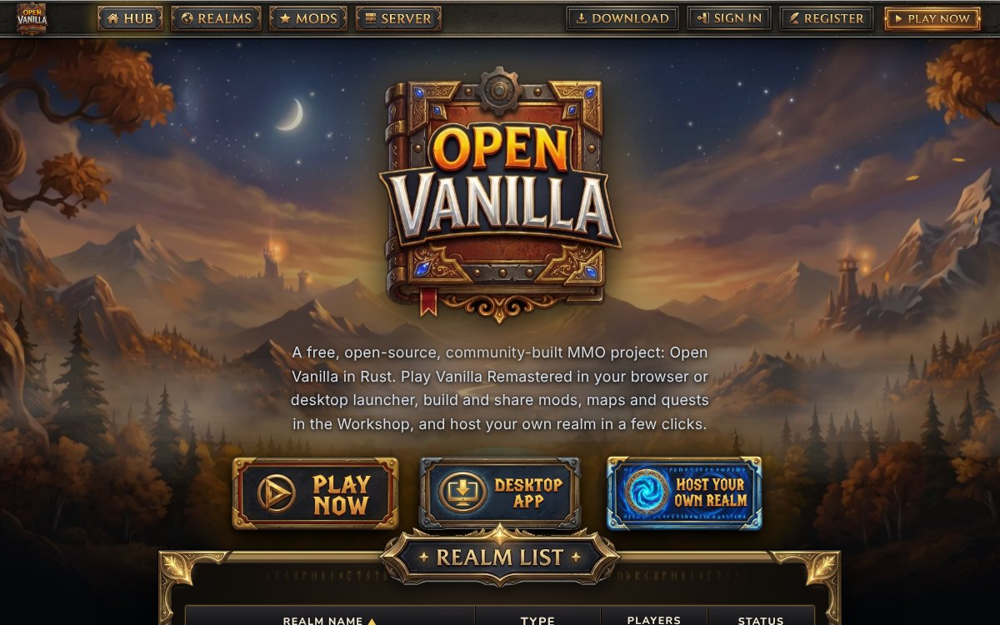
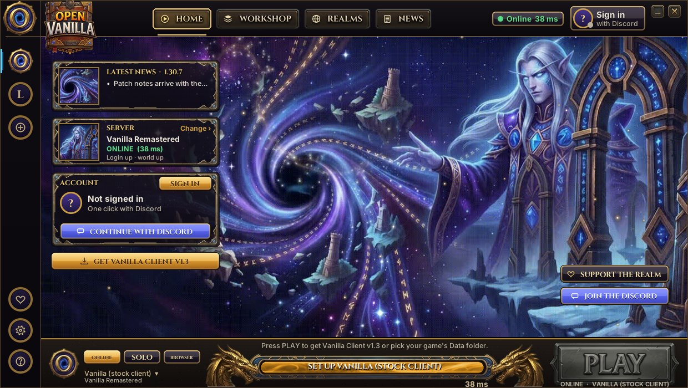
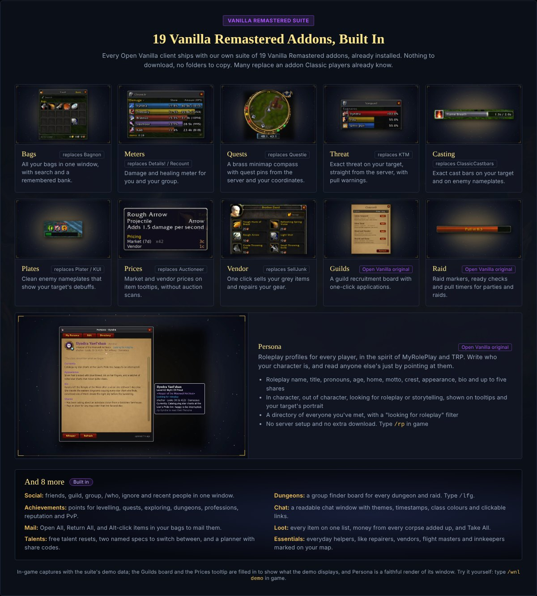
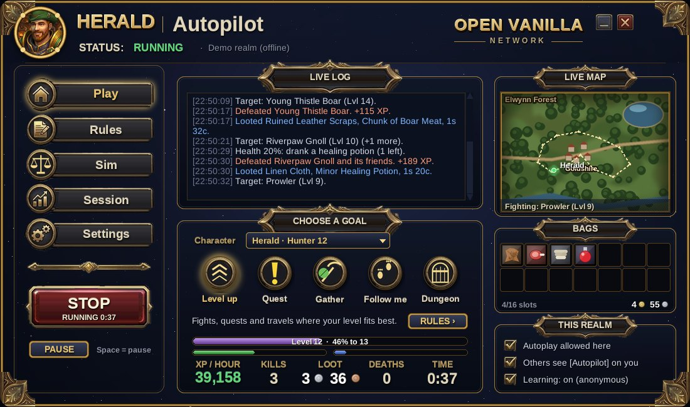
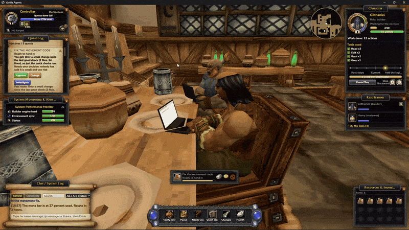
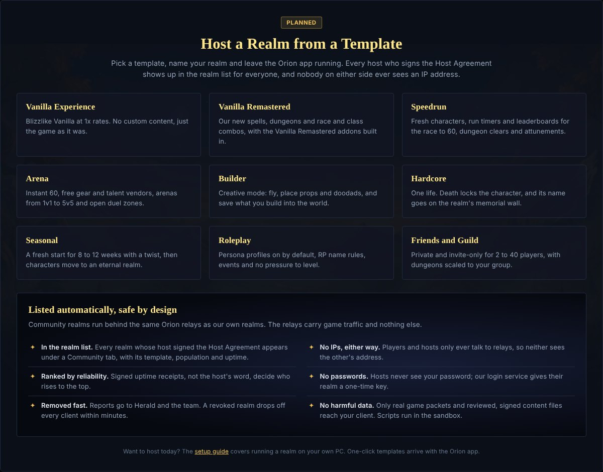
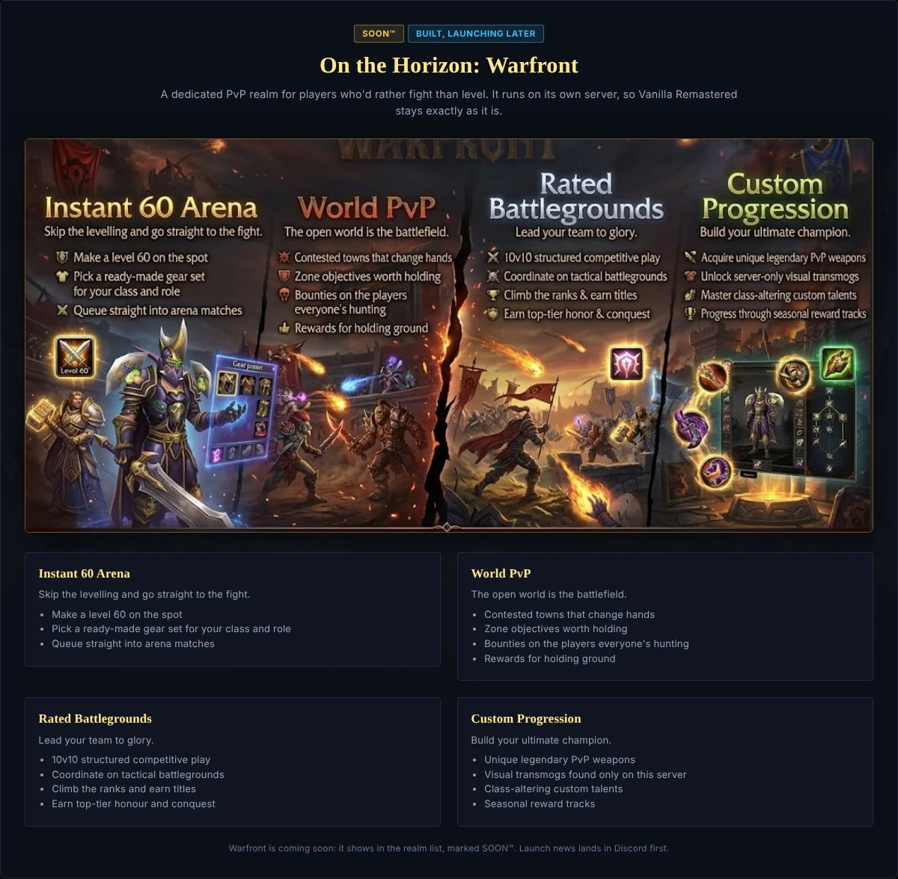

# Open Vanilla

**A free, open-source, community-built Vanilla MMO project, in Rust.** Play Vanilla or Vanilla Remastered in your browser or the desktop launcher, let Herald play for you, build and share mods, and host your own realm in a few clicks.

> **Alpha.** Open Vanilla is in a private alpha with testers from our Discord. Things will break; please report them in [Issues](https://github.com/orionopenwow/OpenVanilla/issues).

**Website:** [openvanilla.app](https://openvanilla.app/) · **Download:** [latest Open Vanilla for Windows](https://github.com/orionopenwow/OpenVanilla/releases/latest) · **Discord:** [join](https://discord.gg/9KGdUDGnv9) · **Support the realm:** [Ko-fi](https://ko-fi.com/orionvanilla)



## Start here

| I want to… | Do this |
| --- | --- |
| **Play** (recommended) | Download **`OpenVanilla-Setup-<version>.exe`** (or the `.zip`) from the [latest release](https://github.com/orionopenwow/OpenVanilla/releases/latest), then run **`OpenVanilla.exe`**. It's the only program you start: it runs the game for you. |
| Play in the browser | Open [openvanilla.app](https://openvanilla.app/) and press **PLAY NOW**. Nothing to install. |
| Play solo, offline | In the launcher, switch PLAY to **SOLO**: it sets up SPP Classics in `Realms\Solo` and starts it. |
| Let Herald play | In game, click **Herald** by the minimap (or `/herald`). On the desktop, run **`Herald Autopilot.bat`**. |
| Host my own realm | Download **Open Vanilla Server** ([OpenVanilla-Server.zip](https://github.com/orionopenwow/OpenVanilla/releases/latest/download/OpenVanilla-Server.zip)). [Guide](https://openvanilla.app/host.html). |
| Play from this source folder | Double-click **`Play Open Vanilla.bat`** (needs Python 3.10+). |
| Work on Open Vanilla | Open a pull request against `main`; see [the contributing page](docs/manual/15-contributing.md). |

You need your own Vanilla game files (build 5875) until Open Vanilla's own Vanilla Data is out. Open Vanilla never ships or changes anyone else's files.

## Realms

| Realm | Type | Status |
| --- | --- | --- |
| **Vanilla Remastered** | PvE | **Online.** Vanilla plus the Vanilla Remastered features: the official realm. |
| **Warfront** | PvP | Soon. Instant 60 arenas, world PvP, rated battlegrounds. |
| **Moonguard** | RP | Soon. A new roleplay realm. |
| **Ascension Resurrected** | Fun | Soon. Details to come. |

The website's realm list shows live status and how many players are online.

---

## The desktop launcher

One window to pick a realm and a game client, sign in with Discord, manage addons and keep Open Vanilla up to date. It runs the native Open Vanilla engine (built on [benilla](https://github.com/samwhosung/benilla)) against your own Vanilla game data, the browser client, or a stock Vanilla client, and sets the realmlist for you. ONLINE, SOLO or BROWSER sit right next to PLAY.



- **Native engine:** `OpenVanilla.exe`, built on the open-source benilla client, with a direct connection to the realm.
- **Accounts and updates:** sign in, change your password and update from the launcher.
- **Offline / LAN:** Play Solo runs a whole world with playerbots on your PC.
- **Workshop and Realms:** addons, game clients and community mods; join any realm by invite link or address.

## 19 Vanilla Remastered addons, built in

Every Open Vanilla client ships with our own suite of 19 Vanilla Remastered addons, already installed. Nothing to download, no folders to copy. Many replace an addon Classic players already know: Bags (Bagnon), Meters (Details! / Recount), Quests (Questie), Threat (KTM), Casting (ClassicCastbars), Plates, Prices (Auctioneer), Vendor (SellJunk), plus Open Vanilla originals like Guilds, Raid and **Persona** roleplay profiles. Social, Dungeons, Achievements, Chat, Mail, Loot, Talents and Essentials round it out.

Turn any of them off with one click (nothing is deleted), install any addon from a `.zip`, and browse community mods and repacks from the shared directory.



## Herald

Herald is Open Vanilla's own self-learning companion: a Hunter in a green hood who plays the game every night, learns what works, finds what's broken, and keeps the Discord running.


- **Runs the Discord (live):** sign-ups and realm access, the support desk for in-game tickets, moderation help, the World chat bridge and live-stream alerts.
- **Tests every release (live):** signs in like a player each night and checks logins, the UI and the addons.
- **Finds and reports bugs:** broken quests, stuck spots and drops that never drop, logged with where and when.
- **Learns from how you play (opt-in):** anonymous run stats only. Never names, chat, positions or account details.

### Herald Autopilot: let him play for you

Hand Herald your character and watch him play it, any race and any class, on any realm whose owner allows it.

1. Log in to your character, then click **Herald** by the minimap (or type `/herald`).
2. Press **Let Herald play** and pick Level up, Quest, Gather or Explore. He plays on the realm's own AI while you watch with your own camera and UI.
3. Press **Take back control** any time.

The **Herald Autopilot** desktop app (`Herald Autopilot.bat`) adds rules in plain sentences ("Rest when health is below 35%"), a Vanilla damage sim that compares two sets of gear, and session numbers. See [autopilot/README.md](autopilot/README.md).



Herald's own characters are always marked as bots. He never counts in PvP rankings, the auction house economy or achievements, and a realm owner can turn him off at any time.

## Vanilla Agents

Your Claude Code helpers as heroes in a vanilla inn. You walk the inn as your own character; your helpers work at their laptops through quests you approve, and a checker runs the real tests before anything counts as done. [More on the website](https://openvanilla.app/agents.html).



## Host your own realm in one click

**Open Vanilla Server** ([OpenVanilla-Server.zip](https://openvanilla.app/downloads/OpenVanilla-Server.zip), on every release) runs a Vanilla realm on your own PC: an [SPP Classics](https://github.com/celguar/spp-classics-cmangos) realm (database, login and world servers with playerbots) plus its website with sign-up and browser play, Server Studio and a GM console, all from one window. It finds your SPP install by itself, sets the address players connect to, and has a **HERALD** button so Herald can play on your server too.


**Coming with the Orion app:** host a realm from a template (Vanilla Experience, Vanilla Remastered, Speedrun, Arena, Builder, Hardcore, Seasonal, Roleplay, Friends and Guild). Signed-up hosts appear in everyone's realm list automatically, behind relays, so nobody on either side ever sees an IP address.



## On the horizon: Warfront

A dedicated PvP realm for players who'd rather fight than level, on its own server: instant 60 arenas, world PvP with contested towns, rated 10v10 battlegrounds, and custom progression with server-only transmogs and seasonal rewards. It's built and shows in the realm list as SOON™; launch news lands in Discord first.



---

## Quick start

**Play with the launcher**
1. From the [latest release](https://github.com/orionopenwow/OpenVanilla/releases/latest), download `OpenVanilla-Setup-<version>.exe` and run it (or take the `.zip`, extract it, and run `OpenVanilla.exe`).
2. Start **Open Vanilla** from the Start menu or your desktop.
3. If it didn't find your Vanilla game folder by itself, PLAY asks for it. Open Vanilla reads its game data and never changes it.
4. Pick ONLINE, SOLO or BROWSER next to PLAY, then press **PLAY**. Updates download by themselves; press **Update ready** to restart into one.

Folders (beside `OpenVanilla.exe` for the zip, `%LOCALAPPDATA%\OpenVanilla` for the installer): `AddOns\Enabled|Disabled`, `Realms\Solo|Hosted`, `Screenshots`, `Logs`, `Backups`, `Settings`, `Cache`. See [docs/LAUNCHER.md](docs/LAUNCHER.md).

**Game data:** Open Vanilla is getting its own data, rewritten and open-sourced (**Get Vanilla Data** on the website; its address is `VANILLA_DATA_URL` in `links.txt`). Until then, the launcher plays from your own Vanilla game folder.

**Play solo, offline:** switch PLAY to SOLO in the launcher. It sets up [SPP Classics](https://github.com/celguar/spp-classics-cmangos) (CMaNGOS with playerbots) in `Realms\Solo` and starts it for you. Solo characters stay on your PC.

**Host a realm:** download [`OpenVanilla-Server.zip`](https://openvanilla.app/downloads/OpenVanilla-Server.zip), extract it and run `Start Open Vanilla Server.bat`. See [host.html](https://openvanilla.app/host.html).

---

## Configuring (`links.txt`)

Every address the website and launcher use lives in `links.txt`, a plain text file you can edit in Notepad: the website, the realm, Discord, downloads and update checks. `VANILLA_DATA_URL` is where the Get Vanilla Data buttons point.

## Repository layout

```
Data/Interface/   the Vanilla Remastered addon suite (and the in-game Herald addon) and its art, packed into realm/classicplus/patch-Z.MPQ
launcher/         desktop launcher (Python, frozen to an .exe by packaging/build_repack.py)
autopilot/        Herald Autopilot, the desktop app: goals, rules, sim, learning (Herald Autopilot.bat runs it)
www/              website, browser client page and downloads (published to GitHub Pages)
realm/            the live realm: wenilla-realm and CMaNGOS patches, Vanilla Remastered SQL, patch-Z
hetzner/          server scripts (realm up, hotpatch, Herald, Herald self-bot, backups) run on the Linux host
bot/              Herald (the Discord bot and the autopilot/learning API) and the one-time Discord setup scripts
studio/           Server Studio, the realm admin web app (studio_server.py runs it)
solo/             the offline single-player realm (play_local.py runs it)
packaging/        release builds: build_repack.py, build_server.py, the installer (installer/OpenVanilla.iss), the signed
                  update manifest (release_manifest.py) and every GitHub workflow (workflows/)
devkit/           tests (lua sim, heraldlite, staging), audit.py and repo tools
tools/            art generators and content tools (tools/autopilot plans Herald's routes)
docs/             architecture notes, the addon report, plans
Play Open Vanilla.bat  opens the launcher from source;  Play Solo.bat  offline world;  Host a Realm.bat  Open Vanilla Server
links.txt         every website, realm and download address
asset_server.py, server_control.py, launcher_gui.py, play_local.py, set_realm.py, authcheck.py, studio_server.py
                  the host / solo server set, which import each other from the root
```

`_local/` (ignored) holds old builds, database dumps, logs and caches; it is never committed.

Releases: work lands on `main`; the maintainer tags releases, which move the `stable` branch the live realm follows. The website publishes from `main` whenever `www/` changes.

## Server Studio (preview)

`studio/` is the realm admin web app: services, players and roles, bans, messages, timed restarts, backups and realm settings, with an undo history. It is drawn entirely from a generated art kit (`tools/gen_ui_art.py` → `tools/build_ui_kit.py` → `www/studio/kit/`); see `www/studio/kit.html`.

- **Windows (SPP):** the website starts it on <http://localhost:18091/studio/>; the control panel has an *Open Server Studio* button.
- **Linux (wenilla-realm Docker stack):** `studio_server.py --mode docker`, see `hetzner/README.md` section 7.
- **Try it:** `py -3 studio_server.py --demo`, sign in as ADMIN / ADMIN.
- **Tests:** `py -3 -m pytest tests/test_studio.py`

It only answers on the computer it runs on and needs a GM 3 account. Guidebook chapter 15 covers it for hosts.

## Credits

The Open Vanilla client is built on [benilla](https://github.com/samwhosung/benilla) (MIT / Apache-2.0). The realm runs on [CMaNGOS](https://github.com/cmangos) and its [playerbots](https://github.com/cmangos/playerbots) through [SPP Classics](https://github.com/celguar/spp-classics-cmangos). The launcher and Herald Autopilot use the [Cinzel](https://fonts.google.com/specimen/Cinzel) and [Marcellus](https://fonts.google.com/specimen/Marcellus) fonts (OFL).

## Legal

World of Warcraft and Blizzard Entertainment are trademarks or registered trademarks of Blizzard Entertainment, Inc. Open Vanilla is an independent fan project, not affiliated with or endorsed by Blizzard Entertainment. No Blizzard game files are distributed with this software; players use their own game data.

<br>

<p align="center">
  
  <br>
  <sub>Made by Orion ❤️</sub>
</p>
